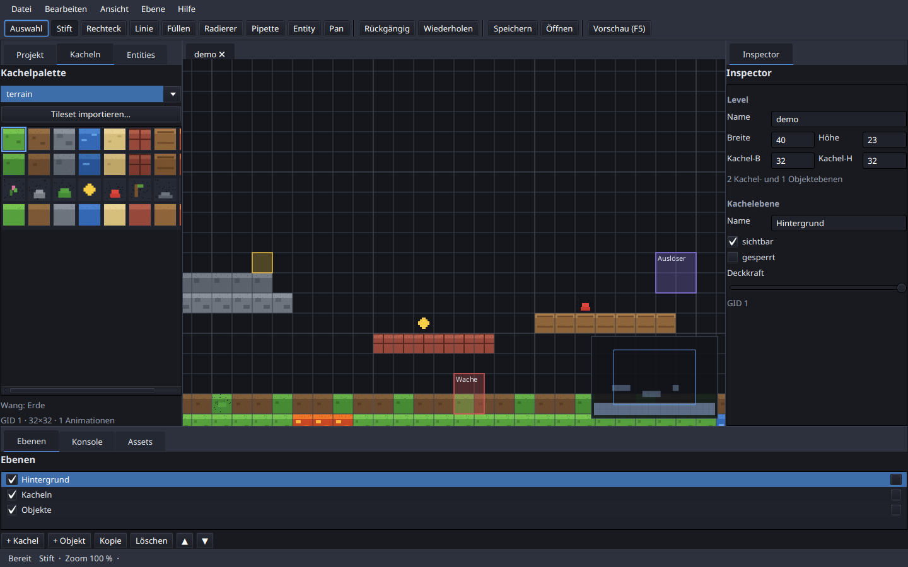
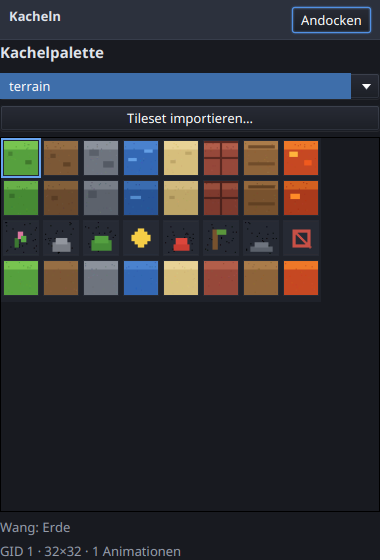
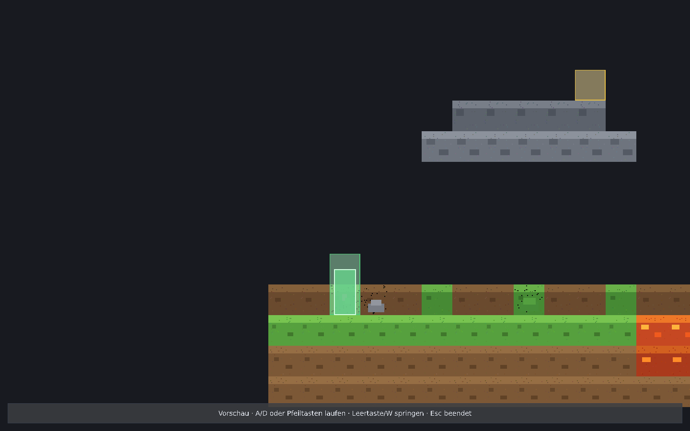

# sgl Leveleditor (Java 25 / JavaFX / FXML / CDI)

Der Leveleditor ist jetzt eine eigenständige Java-25-Anwendung mit JavaFX 25,
FXML-Oberflächen und CDI (Weld SE). Er ersetzt den bisherigen C++-Editor; die
C++-Bibliothek `sgl` bleibt unabhängig davon bestehen.


## Bauen und starten

Voraussetzungen: **JDK 25** und **Maven 3.9+**. JavaFX wird über Maven
bezogen, es ist keine separate JavaFX-Installation nötig.

```bash
cd tools/leveleditor
mvn -q javafx:run
```

Demo-Projekt direkt öffnen:

```bash
mvn -q javafx:run -Djavafx.args="--demo"
```

Oder ein eigenes Projekt:

```bash
mvn -q javafx:run -Djavafx.args="--project /pfad/zu/project.sglproj"
```

Headless-Screenshot (für CI/QA):

```bash
mvn -q javafx:run -Djavafx.args="--demo --frame target/editor.png"
```

Optionen:

| Option | Bedeutung |
|---|---|
| `--project <pfad>` | Projektdatei oder Projektverzeichnis öffnen |
| `--level <name>` | Level mit diesem Namen aktivieren |
| `--tab <0\|1\|2>` | Linkes Dock: Projekt, Kacheln, Entities |
| `--demo` | Demo-Projekt aus `demo/` öffnen |
| `--float <panel>` | Panel als eigenes Fenster öffnen (`project`, `palette`, `inspector`, …) |
| `--play` | Direkt im Playtest starten |
| `--frame <datei>` | Ein Bild rendern und beenden |

Ein Paket bauen:

```bash
mvn -q package
```

## Oberfläche

- **FXML-Shell:** Hauptfenster, Menüs, Toolbar, Statusleiste und alle Panels
  liegen als FXML unter `src/main/resources/fxml/`.
- **CDI:** Services sind `@ApplicationScoped`, Controller `@Dependent`.
  Der FXMLLoader erzeugt Controller über eine CDI-Controller-Factory.
- **Docking:** Linkes, rechtes und unteres Dock mit `TabPane`/`SplitPane`.
  Tabs lassen sich per Drag & Drop zwischen den Docks verschieben; ein
  Doppelklick auf einen Tab löst das Panel in ein eigenes Fenster.
- **Floating-Panels:** Eigene JavaFX-`Stage` mit „Andocken“-Button; Schließen
  dockt das Panel wieder an. Position und Größe werden gespeichert.
- **Layout:** `.sgl/layout.json` im Projektverzeichnis.




## Funktionen

- Projektverwaltung mit mehreren Levels, Tilesets und Entity-Definitionen
- Kachel- und Objektebenen, Sichtbarkeit, Sperren, Deckkraft, Reihenfolge
- Tileset-Import, Palette, Stift, Rechteck, Linie, Füllen, Radierer, Pipette
- Entities mit typisierten Attributen und dynamischem Inspector
- Undo/Redo über Level-Snapshots
- TMJ-/TMX-Import und -Export:
  - CSV, Base64, zlib, gzip
  - externe `.tsx`/`.tsj`-Tilesets
  - Tiled-Templates (`.tx`/`.tj`)
  - Wang-Metadaten (lesen, anzeigen, erhalten)
  - Kachelanimationen
- Playtest (`F5`) mit Schwerkraft, Laufen, Springen, Kamera und Kollision
- Autosave und deutsche Oberfläche
- Native Dateidialoge über JavaFX `FileChooser`



## Tastenkürzel

| Taste | Funktion |
|---|---|
| `Strg+N/O/S` | Neues Projekt / öffnen / speichern |
| `Strg+Shift+S` | Speichern unter |
| `Strg+Z` / `Strg+Y` | Rückgängig / Wiederholen |
| `Strg+W` | Level schließen |
| `V B R L F E I N` | Werkzeuge |
| `G` / `M` | Raster / Minimap |
| `F5` | Vorschau starten/beenden |
| `Esc` | Vorschau beenden |
| `A/D`, `←/→` | In der Vorschau laufen |
| `Leertaste`/`W`/`↑` | In der Vorschau springen |
| `Entf` | Ausgewählte Entity löschen |
| Mittlere Maustaste | Pan |
| Mausrad | Zoom um den Cursor |
| Tab ziehen | Panel andocken oder lösen |
| Tab doppelklicken | Panel als Fenster lösen |

In der Vorschau sind Ebenen mit `Hintergrund` oder `Background` im Namen reine
Deko und tragen keine Kollision. Gibt es nur eine Kachelebene, wird sie immer
als feste Geometrie behandelt.

## Projektlayout

```text
MeinProjekt/
  project.sglproj
  levels/
    level01.tmj
  templates/
    enemy.tj
  assets/
    tilesets/
      terrain.png
  .sgl/
    layout.json
    autosave/
```

## Tests und CI

```bash
mvn -q test
```

Die JUnit-5-Tests prüfen Projekt-/Level-JSON, TMJ-/TMX-Roundtrips,
CSV/Base64/zlib/gzip, Templates, Wang-Metadaten, Animationen, Undo/Redo und
die Playtest-Physik. Der GitHub-Actions-Workflow `java-editor.yml` baut und
testet unter Linux (mit Xvfb und Screenshot-Artefakt), Windows und macOS.

## Grenzen

- Orthogonale, endliche Karten; isometrisch/Infinite Maps folgen später.
- Wang-Metadaten werden erhalten und angezeigt; ein automatischer
  Wang-Pinsel fehlt noch.
- Tiled-Templates werden aufgelöst und mit `template`-Verweis exportiert;
  ein eigener Template-Editor fehlt.
- Image-Layer, Tiled-Gruppen und Infinite-Chunks werden noch nicht importiert.
- Textfelder haben noch keine Bereichsauswahl.
- Es gibt kein Undo für Projektoperationen (nur für Levelinhalte).
