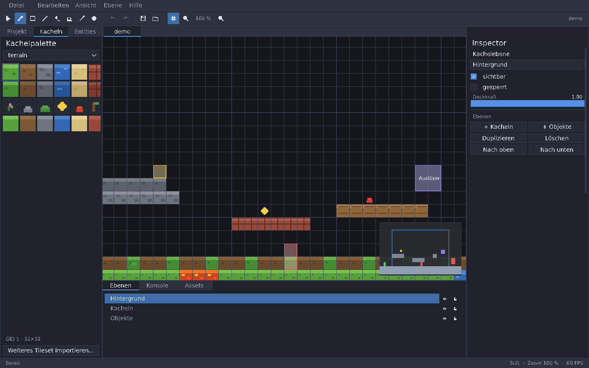
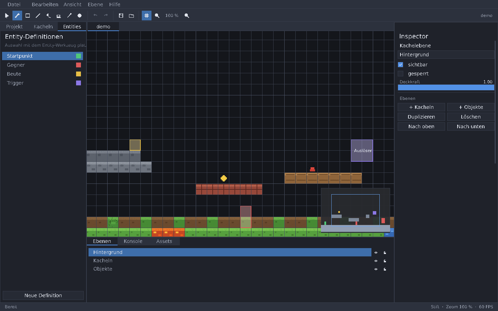

# sgl Leveleditor

Ein 2D-Leveleditor auf Basis von `sgl` – mit eigener Immediate-Mode-GUI,
Tiled-kompatiblem Import/Export und Projektverwaltung. Die Oberfläche ist
deutsch, der Editor läuft auf X11, Wayland, Win32 und Cocoa.



## Bauen und starten

```bash
cmake -S . -B build -G Ninja -DCMAKE_BUILD_TYPE=Release
cmake --build build
./build/tools/leveleditor/sgl_editor
```

Das Demo-Projekt liegt unter `tools/leveleditor/demo` und lässt sich direkt
öffnen:

```bash
./build/tools/leveleditor/sgl_editor --project tools/leveleditor/demo
```

Headless (z. B. für CI oder Screenshots):

```bash
./build/tools/leveleditor/sgl_editor --project tools/leveleditor/demo \
    --frame /tmp/editor.png
./build/tools/leveleditor/sgl_editor --demo --frame /tmp/leer.png
```

Optionen:

| Option | Bedeutung |
|---|---|
| `--project <pfad>` | Projektdatei oder Projektverzeichnis öffnen |
| `--level <name>` | Level mit diesem Namen aktivieren |
| `--tab <0\|1\|2>` | Linkes Panel: Projekt, Kacheln, Entities |
| `--demo` | Temporäres Demo-Projekt unter `/tmp/sgl-editor-demo` anlegen |
| `--frame <datei>` | Ein Bild rendern und als PNG speichern (kein Fenster) |

## Funktionen

- **Projektverwaltung:** `project.sglproj`, mehrere Levels, Tilesets,
  Entity-Definitionen, relative Asset-Pfade.
- **Level:** endliche orthogonale Karten, mehrere Kachel- und Objektebenen,
  Sichtbarkeit, Sperren, Deckkraft, Reihenfolge.
- **Kacheln:** Tileset-Import (PNG/JPG/BMP/TGA), Palette mit Zoom, Stift,
  Rechteck, Linie, Flood-Fill, Radierer, Pipette, GID-Anzeige.
- **Entities:** Definitionen mit typisierten Attributen (`bool`, `int`,
  `float`, `string`, `color`, `enum`, `asset`), Platzieren, Auswählen,
  Verschieben mit Raster-Snap, Inspector mit Attribut-Editoren.

  
- **Bearbeiten:** Undo/Redo über Level-Snapshots, Shortcuts, Mehrfachauswahl
  über Ebenen, Kopieren/Duplizieren von Ebenen.
- **Ansicht:** Pan/Zoom, Raster, Minimap, Statusleiste, Konsole.
- **Tiled:** Import und Export von `.tmj` (JSON) und `.tmx` (XML), inklusive
  CSV-, Base64- und zlib-Kacheldaten, externen Tilesets (`.tsx`/`.tsj`) und
  Objekt-Properties. Unbekannte Properties bleiben als Strings erhalten.
- **Persistenz:** Speichern aller Levels, Projektdatei, Autosave unter
  `.sgl/autosave/`, Drag & Drop von Bildern und Tiled-Dateien.
- **UI:** vollständig in-house (kein ImGui/Qt), gebatchter OpenGL-3.3-Renderer,
  GLSL 3.30, DPI-Skalierung, deutsche Beschriftungen.

## Tastenkürzel

| Taste | Funktion |
|---|---|
| `Strg+N` | Neues Projekt |
| `Strg+O` | Projekt öffnen |
| `Strg+S` | Projekt speichern |
| `Strg+Shift+S` | Projekt speichern unter |
| `Strg+Z` / `Strg+Y` | Rückgängig / Wiederholen |
| `Strg+I` / `Strg+E` | Level importieren / exportieren |
| `V` | Auswahl |
| `B` | Stift |
| `R` | Rechteck |
| `L` | Linie |
| `F` | Füllen |
| `E` | Radierer |
| `I` | Pipette |
| `N` | Entity platzieren |
| `G` | Raster ein/aus |
| `M` | Minimap ein/aus |
| `+` / `-` | Zoom |
| `Entf` | Ausgewählte Entity löschen |
| Mittlere Maustaste | Pan |
| Mausrad | Zoom um den Cursor |
| `Alt` beim Ziehen | Snap vorübergehend aus |

## Projektlayout

```text
MeinProjekt/
  project.sglproj
  levels/
    level01.tmj
    level02.tmj
  assets/
    tilesets/
      terrain.png
  .sgl/
    autosave/
      level01.json
```

`project.sglproj` enthält Name, Level-Liste, Tileset-Katalog und
Entity-Definitionen. Levels werden als Tiled-TMJ gespeichert und können
jederzeit in Tiled geöffnet werden.

## Technik und Plattformunabhängigkeit

Der Editor verwendet bewusst **OpenGL 3.3 / GLSL 3.30** und einen eigenen
Quad-/Text-Renderer statt `sgl::Texture2d`/`sgl::Framebuffer`. Diese Klassen
nutzen Direct State Access (OpenGL 4.5) und stehen auf macOS (maximal 4.1)
nicht zur Verfügung. Fenster, Eingabe, Clipboard, Drag & Drop, Bildladen und
die Schriftnetze kommen aus `sgl`.

- X11: GLX oder EGL (3.3-Kernprofil)
- Wayland: EGL (3.3)
- Windows: WGL (3.3)
- macOS: NSOpenGL (3.3, kompatibel zu 4.1)

Die UI-Schrift (DejaVu Sans) und die Demo-Grafik liegen im Repository, damit
die Darstellung auf allen Plattformen gleich ist.

## Grenzen der aktuellen Version

- Orthogonale, endliche Karten; isometrische und Infinite Maps folgen später.
- TMX-Kompression: CSV, Base64 (unkomprimiert) und zlib; **gzip** wird noch
  nicht entpackt.
- Keine Tiled-Templates (`.tx`), Wang-Tiles/Terrains oder Image-Layer.
- Textfelder unterstützen Caret, Clipboard und `Shift+Pos1/Ende`-Sprung,
  aber noch keine echte Bereichsauswahl.
- Kein Floating-Docking; die Panels sind fest angeordnet und über Splitter
  resizebar.
- Kein Playtest-Modus; Entities und Kachelanimationen werden im Editor
  statisch dargestellt.

## Tests

```bash
ctest --test-dir build --output-on-failure
```

Die Editor-Tests liegen in `tests/test_editor.cpp` (Projekt-/Level-JSON,
Undo/Redo, TMJ-/TMX-Roundtrip, Pfad-/Farbhelfer). Mit
`-DSGL_HEADLESS_RENDER_TESTS=ON` kommt `sgl_editor_headless` hinzu, das das
Demo-Projekt headless rendert.

## Lizenzen

- DejaVu Sans: siehe `assets/fonts/LICENSE.txt`
- tinyxml2: zlib-Lizenz, siehe `third_party/tinyxml2/LICENSE.txt`
- miniz: MIT, siehe `third_party/miniz/LICENSE`
